# KansenKamer — Design- en interactiespecificatie

> Naam gewijzigd van ‘De Kansenmaker’ naar **KansenKamer** (in zinnen: ‘de KansenKamer’). Domein: www.kansenkamer.nl.

Haags Verhaal · Stap 1 (interface), stap 2 (database en rechten) en stap 3 (ideeën- en conceptenstroom) · november 2026

> **Status:** de interface is gekoppeld aan **Supabase** (project `kansenmaker`, regio eu-west-1). Gebruikers loggen
> **wachtwoordloos** in, alle gegevens worden echt opgeslagen en **Row Level Security** in de database dwingt de
> rechten per project en rol af. Werksessies werken live via Supabase Realtime. De voorbeeldgegevens en de
> prototype-rolwisselaar uit stap 1 zijn verwijderd. Database, rechten, inloggen en testen staan in **§15**.
> Nog niet gekoppeld: een e-maildienst voor uitnodigingen (de app toont de link om zelf te versturen).

---

## Inhoud

1. [Uitgangspunten](#1-uitgangspunten)
2. [Huisstijlcontrole](#2-huisstijlcontrole)
3. [Ontwerpvariabelen (design tokens)](#3-ontwerpvariabelen-design-tokens)
4. [Navigatie en layout](#4-navigatie-en-layout)
5. [Route-overzicht](#5-route-overzicht)
6. [Componenten](#6-componenten)
7. [Schermen en interacties](#7-schermen-en-interacties)
8. [Gebruikersstromen](#8-gebruikersstromen)
9. [Rollen en rechten](#9-rollen-en-rechten)
10. [Datamodel](#10-datamodel)
11. [Toegankelijkheid](#11-toegankelijkheid)
12. [Controle: desktop, tablet en mobiel](#12-controle-desktop-tablet-en-mobiel)
13. [Aannames en open punten voor de beoordeling](#13-aannames-en-open-punten-voor-de-beoordeling)
14. [Techniek en ontwikkeling](#14-techniek-en-ontwikkeling)
15. [Database, rechten, inloggen en testen (stap 2)](#15-database-rechten-inloggen-en-testen-stap-2)
16. [Ideeën- en conceptenstroom (stap 3)](#16-ideeën-en-conceptenstroom-stap-3)
17. [Deelnemen met alleen een link (gasten)](#17-deelnemen-met-alleen-een-link-gasten)

---

## 1. Uitgangspunten

- Iemand moet zonder uitleg met het systeem kunnen werken. Geen dashboards, grafieken of lange formulieren.
- Rustig, licht en vriendelijk: gebroken witte achtergrond, donkergroene typografie, warme gele primaire acties.
- **Maximaal één primaire (gele) knop per schermgedeelte.** Overige acties zijn secundair (groene rand) of tekstknoppen.
- **Maximaal drie invoervelden tegelijk zichtbaar.** Langere invoer wordt opgeknipt in stappen (Idee delen) of
  per onderdeel bewerkt (Haalbaarheid).
- Veel witruimte, grote koppen, kaarten met afgeronde hoeken (12–16 px), geen decoratieve illustraties in de werkruimte.
- Mobiel eerst: één kolom, grote aanraakvlakken (≥ 44 px), ‘Deel een idee’ altijd bereikbaar.
- WCAG 2.2 AA als ontwerp- en testdoel.

## 2. Huisstijlcontrole

De gevraagde kleuren zijn **voorlopige tokens**, geen geverifieerde huisstijl. Bij controle van
[haagsverhaal.nl](https://haagsverhaal.nl/) (Elementor-thema, gecontroleerd 3 november 2026) blijkt:

| Kenmerk | Op haagsverhaal.nl | In De Kansenmaker | Actie |
|---|---|---|---|
| Kopletter | **Maven Pro**, vet | Maven Pro 600/700 (Google Fonts, zelf gehost via `next/font`) | Bevestigen |
| Broodtekst | **Open Sans** | Open Sans | Bevestigen |
| Handschriftletter | ‘schrijf’ (eigen font) | Niet gebruikt | Alleen eventueel op startpagina |
| Kleuren website | Teal `#66C1BE`, roze `#F39DAA`, oranje `#F49655`, geel `#FBE962`, rood `#EB1D1D`, magenta `#B6006E`, zwart | Voorstel: donkergroen `#103E30`, warm geel `#E8A638`, gebroken wit `#FAF8F3`, zachtgroen `#E5EBE1` | **Besluit nodig** |

**Conclusie:** de lettertypen van de site zijn overgenomen. Het kleurvoorstel wijkt duidelijk af van de
kleuren op de website. Alle kleuren staan centraal als CSS-variabelen in `src/app/globals.css` (`--km-*`), dus
een definitieve keuze is één aanpassing op één plek. Let bij een wissel op contrast: de websitekleuren (teal,
roze, geel) halen als tekstkleur op wit geen 4,5:1.

## 3. Ontwerpvariabelen (design tokens)

Gedefinieerd in `src/app/globals.css` en via `@theme` beschikbaar als Tailwind-klassen (`bg-km-green`, `text-km-muted` …).

### Kleur

| Token | Waarde | Gebruik | Contrast |
|---|---|---|---|
| `--km-green` | `#103E30` | Titels, navigatie, iconen, focusring | 11,3:1 op gebroken wit |
| `--km-green-hover` | `#1B5443` | Hover van groene elementen | — |
| `--km-yellow` | `#E8A638` | Primaire knoppen, accenten (actieve tab, voortgang) | Donkergroen op geel **5,7:1** |
| `--km-yellow-hover` | `#D9952A` | Hover primaire knop | — |
| `--km-offwhite` | `#FAF8F3` | Pagina-achtergrond | — |
| `--km-softgreen` | `#E5EBE1` | Kaarten, actieve menu-items | Donkergroen 9,9:1 |
| `#FFFFFF` | — | Formulieren en inhoud | — |
| `--km-text` | `#303B34` | Lopende tekst | 11,0:1 |
| `--km-muted` | `#5A6660` | Secundaire tekst | ≥ 4,9:1 op alle achtergronden |
| `--km-line` | `#D6DCD2` | Scheidingslijnen, kaartranden (decoratief) | — |
| `--km-line-strong` (`--input`) | `#8A968E` | Rand van invoervelden | 3,3:1 (≥ 3:1 voor UI-componenten) |
| `--km-danger` / `-soft` | `#B3261E` / `#FBEAE8` | Fouten, verwijderen, obstakel | 6,5:1 |
| `--km-warning-soft` / `-text` | `#FDF1DA` / `#6B4A00` | ‘Nieuw’, ‘Onbekend’, ‘Wacht op goedkeuring’ | > 7:1 |

> **Regel:** geel (`#E8A638`) is **nooit tekstkleur** en nooit de enige drager van informatie: op gebroken wit is
> het contrast maar 2,0:1. Geel wordt alleen gebruikt als vlak met donkergroene tekst.

### Statussen

Iedere status heeft **icoon + tekstlabel + kleur** (nooit alleen kleur), component `StatusBadge`.

| Status | Icoon | Kleuren (achtergrond / tekst) |
|---|---|---|
| Nieuw | Sparkles | `#FDF1DA` / `#6B4A00` |
| In ontwikkeling | CircleDashed | `#E5EBE1` / `#103E30` |
| Te onderzoeken | Search | `#EEEAF6` / `#45386B` |
| Klaar voor proef | FlaskConical | `#DCEFE4` / `#0C5536` |
| Afgerond | CircleCheck | `#ECEBE7` / `#3B3B37` |
| Gearchiveerd (extra) | Archive | wit / muted |
| Wacht op goedkeuring (extra) | Clock | wit / `#6B4A00` |

### Typografie

| Rol | Lettertype | Grootte (mobiel → desktop) |
|---|---|---|
| H1 paginatitel | Maven Pro 700 | 30 → 44 px (overzicht: 36 → 60 px) |
| H2 sectie | Maven Pro 700 | 24 → 30 px |
| H3 kaart/onderdeel | Maven Pro 700 | 18–20 px |
| Lopende tekst | Open Sans 400 | **16 px**, regelafstand 1,6 |
| Inleiding | Open Sans | 18–20 px |
| Labels, metadata | Open Sans 600 | 14–16 px |

Maximaal drie kopniveaus per pagina; precies één `h1` per pagina.

### Ruimte, vorm en maat

| Element | Specificatie |
|---|---|
| Inhoudsbreedte | max. **1200 px** (`max-w-[1200px]`) |
| Zijbalk | **240 px** desktop (≥ 1024 px); tablet standaard ingeklapt tot 72 px, uitklapbaar |
| Ruimte | 8, 16, 24, 32 px (Tailwind 2/4/6/8); secties 40–56 px |
| Radius | 12 px (velden, knoppen), 16 px (kaarten), volledig rond (badges, chips) |
| Knoppen en velden | min. **44 px** hoog (`min-h-11`), grote knop 48 px |
| Iconen | Lucide, lijnstijl, 16–20 px, altijd `aria-hidden` naast tekst |
| Animatie | Subtiel (hover, dialoog-fade); uitgeschakeld bij `prefers-reduced-motion` |

## 4. Navigatie en layout

**Zes hoofdonderdelen** in een vaste zijbalk, elk met een korte omschrijving:

| Onderdeel | Omschrijving | Route |
|---|---|---|
| Overzicht | Mijn projecten en recente activiteit | `/` |
| Ideeën | Ideeën verzamelen en verbeteren (incl. **kansenmuur** als weergave) | `/ideeen` |
| Doelgroepen | Doelgroepen en hun behoeften | `/doelgroepen` |
| Concepten | Ideeën uitwerken en onderzoeken (incl. onderzoek en acties) | `/concepten` |
| Sessies | Samen ideeën ontwikkelen | `/sessies` |
| Beheer | Projecten, uitnodigingen en instellingen | `/beheer` |

- **Desktop (≥ 1024 px):** zijbalk 240 px met logo, menu, gele knop ‘Deel een idee’ en ‘Menu inklappen’.
- **Tablet (768–1023 px):** zijbalk ingeklapt tot iconen (72 px) met tooltip; ‘Menu uitklappen’ toont de labels.
- **Mobiel (< 768 px):** hamburgerknop opent het menu als zijpaneel (dialoog met focusval, Esc sluit).
  Een **zwevende gele knop ‘Deel een idee’** staat altijd rechtsonder (niet op het formulier zelf en niet op
  het begeleiderscherm). De projectkiezer staat onder de header over de volle breedte.
- **Header:** projectkiezer en gebruikersmenu (naam, e-mailadres, rol; **Mijn profiel** en **Uitloggen**).
- **Skiplink** ‘Naar de inhoud’ is de eerste tabstop op elke pagina.
- **Focuslayout** (`(focus)`-routegroep) zonder zijbalk voor de sessieruimte, het printoverzicht en de uitnodigingspagina.

## 5. Route-overzicht

| # | Scherm | Route | Bestand (scherm) | Toegang |
|---|---|---|---|---|
| 1 | Overzicht / startscherm | `/` | `screens/overview.tsx` | Iedereen; zonder project → startscherm |
| 2 | Ideeënoverzicht (kaarten, lijst, kansenmuur) | `/ideeen` | `screens/ideas.tsx` | Projectleden |
| 3 | Idee toevoegen (3 stappen) | `/ideeen/nieuw` | `screens/idea-new.tsx` | Projectleden |
| 4 | Ideedetail met reacties en aanvullingen | `/ideeen/[id]` | `screens/idea-detail.tsx` | Projectleden (wachtende ideeën: auteur + moderatoren) |
| 5 | Doelgroepenoverzicht | `/doelgroepen` | `screens/audiences.tsx` | Projectleden; beheren: redacteur+ |
| 6 | Doelgroepdetail met behoeften | `/doelgroepen/[id]` | `screens/audience-detail.tsx` | Projectleden |
| 7 | Conceptenoverzicht | `/concepten` | `screens/concepts.tsx` | Projectleden; nieuw concept: redacteur, begeleider, beheerder |
| 8 | Conceptdetail, 5 tabbladen | `/concepten/[id]?tab=overzicht\|kansen\|haalbaarheid\|onderzoek\|acties` | `screens/concept-detail.tsx` | Projectleden; wijzigen: conceptbeheerders |
| 9 | Realiteitstoets ✓ ? × | `/concepten/[id]/realiteitstoets` | `screens/reality-check.tsx` | Bekijken: iedereen; beoordelen: conceptbeheerders |
| 10 | Sessiesoverzicht | `/sessies` | `screens/sessions.tsx` | Projectleden; plannen: begeleider, beheerder |
| — | Sessiepagina (info, link/QR, resultaten) | `/sessies/[id]` | `screens/session-detail.tsx` | Projectleden |
| 11 | Sessieruimte voor deelnemer | `/sessie/[id]` | `screens/participant.tsx` | Leden van het project van de sessie |
| 12 | Begeleiderscherm, 6 rondes + timer | `/sessies/[id]/begeleiden` | `screens/facilitator.tsx` | Begeleider, beheerder |
| 13 | Project- en gebruikersbeheer | `/beheer?tab=overzicht\|projecten\|gebruikers\|sessies\|inhoud\|instellingen` | `screens/admin.tsx` | Redacteur, begeleider, beheerder (tabbladen per rol) |
| — | Printvriendelijk overzicht | `/beheer/print` | `screens/print-overview.tsx` | Beheerder |
| — | Uitnodiging (landingspagina toegangslink) | `/uitnodiging/[id]` | `app/(focus)/uitnodiging/[id]/page.tsx` | Openbaar; meldt dat accepteren nog niet kan |
| — | Niet gevonden | elke onbekende URL | `app/not-found.tsx` | — |
| — | Foutpagina | bij een renderfout | `app/error.tsx` | — |

Pagina-bestanden staan in `src/app/(app)/…` (met AppShell) en `src/app/(focus)/…` (zonder zijbalk). Elke
`page.tsx` is een dunne server-component die het scherm uit `src/components/screens/` rendert.

## 6. Componenten

Alle Kansenmaker-componenten staan in `src/components/km/`; shadcn/ui-basiscomponenten (Radix) in
`src/components/ui/` (aangepast naar 44 px hoogte, 16 px tekst en de tokens).

| Component | Bestand | Doel en gedrag | Toegankelijkheid |
|---|---|---|---|
| **AppShell** | `app-shell.tsx` | Skiplink, zijbalk, header, `<main id="inhoud">` (max 1200 px), mobiele ‘Deel een idee’-knop | Landmarks, skiplink |
| **Sidebar** | `sidebar.tsx` | Zes onderdelen met omschrijving, primaire actie, in-/uitklappen (desktop 240 px, tablet 72 px) | `nav` met `aria-label`, `aria-current="page"`, `aria-expanded` op inklapknop, tooltips bij iconen |
| **Header** | `header.tsx` | Mobiel menu, projectkiezer, gebruikersmenu (profiel, uitloggen) | Toegankelijke namen beginnen met zichtbare tekst |
| MobileNav | `mobile-nav.tsx` | Menu als zijpaneel op mobiel; sluit na navigeren | Dialoog met focusval, Esc |
| ProjectPicker | `project-picker.tsx` | Wisselt project; alle inhoud is per project afgeschermd | Gelabelde select |
| ProfileDialog / ProfileForm | `profile-dialog.tsx` | Naam en organisatie wijzigen; ook als vraag op het overzicht zolang de naam ontbreekt | Gelabelde velden |
| SessionInvite | `session-invite.tsx` | Deelnamelink + QR-code voor een sessie (uitnodiging, 7 dagen geldig) | Link ook als tekst |
| LoadingState | `guards.tsx` | Laadweergave tijdens ophalen (voorkomt misleidende lege toestanden) | `role="status"` |
| **PageHeader** | `page-header.tsx` | Terug-link, bovenregel, `h1`, beschrijving, meta (badges), acties | Eén `h1` |
| **PrimaryButton** | `primary-button.tsx` | De gele primaire actie; met `href` een link in knopvorm | ≥ 44 px, focusring |
| Button-varianten | `ui/button.tsx` | `default` (geel), `outline` (secundair), `secondary`, `ghost`, `destructive`, `link` | Tekst breekt af i.p.v. overlopen |
| **IdeaCard** | `idea-card.tsx` | Kaart (of lijstrij) met doelgroepen, status, beschrijving, aantal bijdragen | Hele kaart klikbaar via één link (één tabstop) |
| **AudienceCard** | `audience-card.tsx` | Doelgroep in zachtgroen met aantallen behoeften/ideeën/concepten | Idem |
| **ConceptCard** | `concept-card.tsx` | Concept met status, doelgroepen, eigenaar, aantal ideeën en open acties | Idem; `dl` voor metadata |
| **StatusBadge** | `status-badge.tsx` | Vijf statussen + ‘Gearchiveerd’ en ‘Wacht op goedkeuring’ | Icoon + label, sr-tekst ‘Status:’ |
| **EmptyState** | `empty-state.tsx` | Icoon, kop, uitleg en één vervolgactie | Kopniveau instelbaar |
| **FilterBar** | `filter-bar.tsx` | Zoekveld, selects (doelgroep, sorteren), statuschips, weergavewissel, resultaat, ‘Filters wissen’ | Chips met `aria-pressed`, resultaat in `role="status"` |
| **StepForm** | `step-form.tsx` | Stappen met voortgang, validatie per stap, Vorige/Volgende/Annuleren | Focus naar stapkop bij wissel, foutoverzicht krijgt focus |
| FormField / ErrorSummary | `form-field.tsx` | Label, hulptekst, foutmelding; foutoverzicht bovenaan | `aria-describedby`, `aria-invalid`, `role="alert"` |
| SampleDataNotice | `form-field.tsx` | Gestippelde badge ‘Voorbeeldgegevens’ | Tekst, geen kleur-alleen |
| **AssessmentControl** | `assessment-control.tsx` | Eén stelling met ✓ Aannemelijk / ? Onbekend / × Obstakel | **Native radioknoppen** in `fieldset`/`legend`; pijltjestoetsen |
| **SessionRound** | `session-round.tsx` | Ronde X van 6, titel, duur, opdracht; ook groot (presentatie) | `section` met label |
| RoundProgress | `session-round.tsx` | Zes balkjes voortgang | Lijst met `aria-label` |
| **Timer** + `useTimer` | `timer.tsx` | Aftellen per ronde; start/pauze, +1 minuut, opnieuw; gedeelde klok voor presentatiemodus | `role="timer"`; alleen mijlpalen (5 min, 1 min, tijd om) worden aangekondigd |
| **ConfirmDialog** | `confirm-dialog.tsx` | Bevestiging voor archiveren, verwijderen, afsluiten, klaar voor proef | `alertdialog`, focus start op **Annuleren** |
| **Toast** / `notify` | `toast.tsx` | Statusmeldingen (sonner). `notify.after(actie, tekst)` meldt succes pas nadat de database de wijziging bevestigt; fouten meldt de gegevenslaag | `aria-live`, sluitknop |
| ConceptCreateDialog | `concept-create-dialog.tsx` | Ideeën combineren tot concept (naam, beschrijving, ideeën) | Gevalideerd formulier |
| InviteLink | `invite-link.tsx` | Deelnamelink + QR-code + kopiëren | Gelabeld veld, QR met titel |
| SessionStateBadge | `session-state-badge.tsx` | Gepland / Actief / Afgesloten | Icoon + label |
| Guards | `guards.tsx` | `RequireProject`, `AccessDenied`, `NotInProject` | Verklapt niets over andere projecten |

## 7. Schermen en interacties

Alle wijzigingen hieronder worden in Supabase opgeslagen. Een succesmelding verschijnt pas als de database de
wijziging heeft bevestigd; lukt het niet (geen rechten, geen verbinding, ongeldige invoer), dan volgt een
Nederlandstalige foutmelding en blijft de invoer staan.

### 1 · Overzicht (`/`)
- Bovenregel ‘HAAGS VERHAAL’, titel ‘De Kansenmaker’, ‘Samen ontdekken we nieuwe mogelijkheden.’, actief project.
- Primaire knop **Deel een idee** → `/ideeen/nieuw`.
- Vier navigatiekaarten (Ideeën · Bekijk en vul aan, Doelgroepen · Ontdek behoeften, Concepten · Werk ideeën uit, Sessies · Denk samen verder) met aantallen.
- **Recent toegevoegd:** drie nieuwste ideeën; leeg → EmptyState met ‘Deel een idee’.
- **Mijn openstaande acties:** acties toegewezen aan de gebruiker, gesorteerd op deadline; ‘Te laat’ in rood met tekst.
- **Uitnodigingen voor sessies:** actieve sessie → ‘Doe mee’ (geel), geplande → ‘Bekijk’.
- **Recente activiteit:** zes laatste gebeurtenissen (ook nieuwe ideeën/bijdragen uit deze sessie).
- **Zonder project** (fictieve ‘Nieuwe gebruiker’): startscherm met uitleg in drie stappen en veld ‘Uitnodigingscode of link’. Leeg → fout ‘Vul de uitnodigingscode of -link in.’; ingevuld → fout dat uitnodigingen nog niet gecontroleerd kunnen worden (geen database).

### 2 · Ideeën (`/ideeen`)
- Zoekveld (titel + beschrijving), select **Doelgroep**, select **Sorteren** (nieuwste, oudste, meeste bijdragen, A–Z).
- Statuschips: Alles, Nieuw, In ontwikkeling, Te onderzoeken, Klaar voor proef, Afgerond, Gearchiveerd.
- Weergave: **Kaarten** (standaard), **Lijst** (compact), **Kansenmuur** (briefjes per status).
- Resultaattelling wordt aangekondigd; ‘Filters wissen’ verschijnt zodra er een filter actief is.
- Paginering per 6 (Vorige / Pagina x van y / Volgende); focus springt naar het begin van de resultaten.
- Lege toestanden: geen ideeën in project · geen resultaten bij filters.
- Ideeën die op goedkeuring wachten zijn alleen zichtbaar voor auteur en moderatoren.

### 3 · Idee toevoegen (`/ideeen/nieuw`)
| Stap | Velden (max. 3) | Validatie |
|---|---|---|
| 1 · Wat is je idee? | Naam (≤ 80 tekens), beschrijving (15–1000 tekens, teller) | Verplicht, met foutoverzicht en foutmelding per veld |
| 2 · Voor wie en waarom? | Doelgroepen (meerdere), passende behoeften (verschijnen na kiezen doelgroep), **optioneel**: ‘Welke behoefte of welk probleem lost dit op?’ | Alles optioneel — mag overgeslagen worden |
| 3 · Controleer en deel | Samenvatting; melding als het project goedkeuring vereist | — |
- Knoppen: Annuleren (stap 1) / Vorige, Volgende / **Deel je idee**. Annuleren met ingevulde gegevens → ConfirmDialog ‘Stoppen met dit idee?’.
- Na delen: naar het nieuwe idee + melding.

### 4 · Ideedetail (`/ideeen/[id]`)
- Titel, status, doelgroepen, auteur en datum; beschrijving; blok ‘Welke behoefte of welk probleem lost dit op?’.
- Zijkolom: **Status** wijzigen (conceptbeheerders), gekoppelde **behoeften**, **concepten** waar het idee deel van is, **gerelateerde ideeën**, **Archiveren** (ConfirmDialog) / Terugzetten.
- Acties: **Bewerken** (auteur of moderator; dialoog met 3 velden) en **Maak er een concept van** (conceptbeheerders).
- **Reacties en aanvullingen:** keuze ‘Reactie — een vraag of mening’ of ‘Aanvulling — maak het idee sterker’, tekst (≤ 1000). Leeg → fout. Aanvullingen krijgen een groene rand en label.
- Moderatoren: bijdrage **Verbergen/Tonen**, **Goedkeuren** bij wachtende bijdragen.
- Uitgeschakeld reageren (projectinstelling) of gearchiveerd idee → uitleg in plaats van formulier.
- Onbekend id of idee uit ander project → ‘Dit idee is niet gevonden’ (zonder details).

### 5 · Doelgroepen (`/doelgroepen`)
- Zoeken, categoriechips, AudienceCards (zachtgroen).
- **Doelgroep toevoegen** (redacteur+, dialoog: naam, beschrijving, categorie).
- **Samenvoegen** (beheerder): kies bron en doel → ConfirmDialog → behoeften, ideeën en concepten verhuizen.

### 6 · Doelgroepdetail (`/doelgroepen/[id]`)
- **Mogelijke behoeften** met per behoefte ‘Bediend door: [concepten]’ en aantal ideeën.
- **Nieuwe behoefte** toevoegen (leeg of dubbel → fout), behoefte verwijderen (ConfirmDialog; ontkoppelt ook).
- Zijkolom: gekoppelde concepten (met status) en ideeën. **Bewerken** van de doelgroep.

### 7 · Concepten (`/concepten`)
- Zoeken, statuschips met aantallen, ConceptCards. **Nieuw concept** (conceptbeheerders) → dialoog: naam, beschrijving, ideeën kiezen (min. 1). Ideeën blijven bestaan.

### 8 · Conceptdetail (`/concepten/[id]`)
- Kop met status, eigenaar, ‘Bevestigd door …’ en knop **Realiteitstoets**.
- Paneel **Status** + **Verantwoordelijke** (verantwoordelijke wijzigen: alleen beheerder).
  - **Klaar voor proef** door een niet-beheerder → foutmelding ‘Alleen een beheerder kan bevestigen…’.
  - Door een beheerder → ConfirmDialog met de uitkomst van de realiteitstoets; bevestiging wordt vastgelegd.
- Tabbladen (URL `?tab=` deelbaar; pijltjestoetsen):
  1. **Overzicht** — beschrijving, onderscheidend vermogen, **bijdrage aan ontmoeting en verbinding** (missievraag), doelgroepen, behoeften, gebaseerd op ideeën. Bewerken: dialoog met 3 velden.
  2. **Kansen en risico’s** — drie kolommen: Kansen (extern, helpt), Bedreigingen (extern, werkt tegen), Belemmeringen (intern). Toevoegen (soort + omschrijving), verwijderen.
  3. **Haalbaarheid** — Mensen, Middelen, Partners, Missie, Ontbrekende kennis; ieder blok apart ‘Wijzig’ (één veld tegelijk).
  4. **Onderzoek** — aannames met methode, status (Nog te doen / Bezig / Afgerond) en resultaat. ‘Afgerond’ vraagt eerst het resultaat (dialoog). Link naar realiteitstoets met huidige uitkomst.
  5. **Acties** — omschrijving, verantwoordelijke, deadline (niet in het verleden), status; afvinken met checkbox; ‘Te laat’ gemarkeerd met icoon + tekst.

### 9 · Realiteitstoets (`/concepten/[id]/realiteitstoets`)
Vijf stellingen met ✓ Aannemelijk · ? Onbekend · × Obstakel:
1. Er is een herkenbare behoefte
2. Het Haags Verhaal voegt iets unieks toe
3. Het concept past bij de missie
4. Uitvoering lijkt mogelijk met mensen en partners
5. **Het draagt bij aan ontmoeting, verbinding of verhalen die anders niet gehoord worden** (met de missievraag als hulptekst)

**Uitkomst** (live bijgewerkt, `role="status"`):
| Situatie | Uitkomst |
|---|---|
| Niets beoordeeld | Nog niet beoordeeld |
| Minstens één × | Er is minstens één obstakel — bespreek eerst of het op te lossen is |
| Minstens één ? of open punt | **Er ontbreken nog gegevens. Formuleer eerst een aantal onderzoeksvragen.** |
| Alles ✓ | Alle punten lijken aannemelijk — de beheerder kan besluiten over een proef |

Knop **Maak onderzoeksvragen van de onbekende punten** zet elk ‘?’ om in een onderzoeksvraag (geen dubbele).
Vaste tekst: ‘Deze beoordeling is geen automatische goedkeuring. De beheerder bepaalt of een concept verdergaat.’

### 10 · Sessies (`/sessies`)
- Groepen **Nu actief**, **Gepland**, **Afgesloten** met datum, locatie, aantal deelnemers en begeleider.
- Knoppen: Doe mee (actief), Begeleiden (begeleider/beheerder), Bekijk resultaten (afgesloten).
- **Nieuwe sessie** (dialoog: titel, datum/tijd — niet in het verleden, locatie) → sessiepagina.
- **Sessiepagina** (`/sessies/[id]`): deelnamelink + **QR-code** + kopiëren, de zes rondes (huidige gemarkeerd), deelnemers, **Sessie afsluiten** (ConfirmDialog), resultaten per ronde met stemmen en **CSV-export**.

### 11 · Sessieruimte deelnemer (`/sessie/[id]`)
- Eigen rustige layout. Toont **alleen de actieve opdracht**: voortgang, ronde X van 6, titel, duur, opdracht.
- Eén tekstveld + **Verstuur** (leeg/te lang → fout); eigen bijdragen van deze ronde eronder.
- **Stemronde (6):** ideeën uit ronde 3 en 4 als drukknoppen (`aria-pressed`), **max. 3 stemmen** (meer → foutmelding), teller wordt aangekondigd. Stemmen uitgeschakeld in project → uitleg.
- Gepland → ‘De sessie is nog niet begonnen’ (wordt vanzelf bijgewerkt); afgesloten → bedankt + resultaten.
- Geen lid van het project of onbekende link → ‘Deze sessie is niet beschikbaar’.

### 12 · Begeleiderscherm (`/sessies/[id]/begeleiden`)
- ‘LIVE WERKSESSIE’, titel, status. Gepland → **Start de sessie** (met link/QR).
- Huidige ronde (SessionRound), **Timer** (start/pauze, +1 minuut, opnieuw; reset bij rondewissel), **Vorige / Volgende ronde**; laatste ronde → **Sessie afronden** (ConfirmDialog).
- Rondelijst: direct naar een ronde springen (`aria-current="step"`).
- **Binnenkomende antwoorden** van de huidige ronde met **Verbergen/Tonen**; in de stemronde gesorteerd op stemmen.
- **Uitnodigen** klapt link + QR open. **Presentatiemodus**: schermvullend, grote ronde, grote timer (dezelfde klok), zichtbare antwoorden, Vorige/Volgende; **Esc** of ‘Sluiten’.
- **Live** via Supabase Realtime: rondewissels, nieuwe antwoorden, verborgen antwoorden en stemmen verschijnen direct bij begeleider én deelnemers, op elk apparaat.
- **Uitnodigen** maakt een deelnamelink + QR-code (uitnodiging met rol deelnemer, 7 dagen geldig). Nieuwe mensen loggen in, worden lid van het project en komen direct in de sessieruimte.

### 13 · Beheer (`/beheer`)
Tabbladen per rol:
| Tab | Inhoud | Rollen |
|---|---|---|
| Overzicht | Aantallen (ideeën, concepten, deelnemers, komende sessies), openstaande beoordelingen, conceptstatussen, recente activiteit — **geen grafieken** | Redacteur, begeleider, beheerder |
| Projecten | Projecten maken, wijzigen, archiveren/herstellen, openen | Beheerder |
| Gebruikers | Leden met rol (wijzigen: beheerder; eigen rol niet), uit project halen (ConfirmDialog). **Uitnodigen**: via e-mail (geeft eerlijke fout: geen e-maildienst) of **toegangslink** met vervaldatum (7/14/30 dagen). Uitnodigingen met status Actief/Verlopen/Ingetrokken en **Intrekken**. Begeleiders nodigen alleen deelnemers uit. | Begeleider, beheerder |
| Sessies | Alle sessies, **Afsluiten** | Begeleider, beheerder |
| Inhoud | Wachtende ideeën (goedkeuren/archiveren), wachtende of verborgen bijdragen (goedkeuren/tonen/verbergen), link naar doelgroepen samenvoegen | Redacteur, beheerder |
| Instellingen en export | Schakelaars: deelname op uitnodiging, ideeën direct zichtbaar, reageren, stemmen, bijdragen eerst goedkeuren. Export: **Ideeën (CSV)**, **Concepten (CSV)**, **Printvriendelijk overzicht** | Beheerder |
- Deelnemer → ‘Je hebt geen toegang tot dit onderdeel’ met uitleg.

## 8. Gebruikersstromen

1. **Idee delen** — Overzicht of overal ‘Deel een idee’ → stap 1 (naam, beschrijving) → stap 2 (doelgroep, optionele behoefte/probleem) → stap 3 controleren → Deel je idee → ideedetail.
2. **Idee aanvullen** — Ideeën → filter/zoek → kaart → kies Reactie of Aanvulling → Plaats bijdrage.
3. **Doelgroep verkennen** — Doelgroepen → kaart → behoeften met de concepten die ze bedienen → ideeën voor deze doelgroep.
4. **Van ideeën naar concept** — Ideedetail ‘Maak er een concept van’ of Concepten ‘Nieuw concept’ → ideeën kiezen → conceptdetail.
5. **Concept onderzoeken** — Overzicht invullen (incl. missiebijdrage) → Kansen en risico’s → Haalbaarheid → Realiteitstoets → ‘Maak onderzoeksvragen’ → Onderzoek: status en resultaat → Acties met verantwoordelijke en deadline.
6. **Klaar voor proef** — Beheerder kiest status ‘Klaar voor proef’ → bevestigingsdialoog toont de uitkomst van de realiteitstoets → bevestigen → ‘Bevestigd door …’.
7. **Werksessie van 90 minuten** — Begeleider: Sessies → Nieuwe sessie → link/QR delen → Begeleiden → Start → zes rondes (10+15+25+15+15+10 min) met timer en presentatiemodus → antwoorden modereren → stemronde → Sessie afronden → resultaten exporteren. Deelnemer: QR/link → sessieruimte → per ronde antwoord versturen → stemmen.
8. **Mensen uitnodigen** — Beheer → Gebruikers → Uitnodigen → toegangslink (rol, geldigheid) → link kopiëren; intrekken in de lijst.
9. **Modereren** — Beheer → Instellingen ‘Bijdragen eerst goedkeuren’ aan → nieuwe ideeën/bijdragen krijgen ‘Wacht op goedkeuring’ → Beheer → Inhoud → goedkeuren.
10. **Nieuwe gebruiker zonder project** — startscherm met uitleg en uitnodigingsveld (geen leeg dashboard).

## 9. Rollen en rechten

Centraal vastgelegd in `src/lib/permissions.ts` (`can(role, permission)`); rechten gelden **per project**.

| Functie | Deelnemer | Redacteur | Begeleider | Beheerder |
|---|:-:|:-:|:-:|:-:|
| Idee toevoegen | ✓ | ✓ | ✓ | ✓ |
| Eigen ideeën wijzigen | ✓ | ✓ | ✓ | ✓ |
| Ideeën van anderen aanvullen | ✓ | ✓ | ✓ | ✓ |
| Bijdragen modereren | — | ✓ | — | ✓ |
| Concepten beheren (incl. doelgroepen/behoeften) | — | ✓ | ✓ | ✓ |
| ‘Klaar voor proef’ bevestigen, verantwoordelijke toewijzen | — | — | — | ✓ |
| Sessies begeleiden | — | — | ✓ | ✓ |
| Gebruikers uitnodigen | — | — | ✓ (alleen deelnemers) | ✓ |
| Projectinstellingen wijzigen, export | — | — | — | ✓ |
| Gebruikersrechten beheren, doelgroepen samenvoegen | — | — | — | ✓ |

De matrix wordt **in de database** afgedwongen met Row Level Security en guard-triggers (§15); de interface
verbergt daarnaast knoppen die je niet mag gebruiken. Wie welke rol heeft, stelt de beheerder in via
Beheer → Gebruikers of via de rol in een uitnodiging.

## 10. Datamodel

Interface-types in `src/lib/types.ts`, databasetypes in `src/lib/database.types.ts`, tabellen in `supabase/migrations/`.
Objecten volgens het functioneel ontwerp: **Project** (+ instellingen), **Doelgroep**, **Behoefte**, **Idee**,
**Concept** (met kansen/bedreigingen/belemmeringen, haalbaarheid, onderzoek, realiteitstoets), **Actie**, plus
gebruikers, lidmaatschappen (rol per project), sessies, sessie-antwoorden (met stemmen), bijdragen
(reactie/aanvulling), uitnodigingen en activiteit.

Functionele regels (afgedwongen in de database): idee ↔ meerdere doelgroepen; concept uit meerdere ideeën; idee
blijft bestaan na koppeling; ‘Klaar voor proef’ pas na bevestiging door bevoegde gebruiker; deelnemer wijzigt alleen
eigen bijdragen; inhoud van andere projecten is nooit zichtbaar (ook niet via een directe URL); gearchiveerde
ideeën verdwijnen uit gewone overzichten (filter ‘Gearchiveerd’ toont ze).

## 11. Toegankelijkheid

Maatregelen (doel WCAG 2.2 AA):
- **Contrast:** alle tekstkleuren ≥ 4,5:1, invoerranden ≥ 3:1 (zie §3); geel nooit als tekst.
- **Toetsenbord:** skiplink; logische tabvolgorde; zichtbare focusring (3 px donkergroen, 2 px offset);
  tabbladen en radiogroepen met pijltjestoetsen; dialogen met focusval, Esc en focusherstel; ConfirmDialog
  start op ‘Annuleren’; kaarten hebben één link (één tabstop).
- **Doelgrootte:** knoppen, velden, chips en menu-items ≥ 44 × 44 px (ruim boven WCAG 2.2 2.5.8, 24 px).
- **Formulieren:** zichtbare labels, hulptekst en fouten gekoppeld met `aria-describedby`, `aria-invalid`,
  foutoverzicht met focus; geen validatie alleen op kleur.
- **Status niet alleen met kleur:** statussen, ‘te laat’, verborgen bijdragen en realiteitstoets hebben tekst/icoon.
- **Live-regio’s:** resultaattellingen, uitkomst realiteitstoets, stemteller, timer-mijlpalen, toasts.
- **Structuur:** `lang="nl"`, één `h1` per pagina, landmarks (`header`, `nav`, `main`, `aside`), `aria-current`.
- **Beweging:** `prefers-reduced-motion` schakelt animaties en overgangen uit.
- **Reflow:** geen horizontaal scrollen op 390 px breed; tekst kan vergroot worden (relatieve eenheden).

Bekende beperkingen: nog niet getest met echte schermlezers (NVDA, VoiceOver) en niet met gebruikers; dat staat
gepland voor stap 5. QR-code is een aanvulling, de link is altijd ook als tekst beschikbaar.

## 12. Controle: desktop, tablet en mobiel

Uitgevoerd op de productiebuild (`next build && next start`) met Playwright/Chromium:

**Visueel en toegankelijkheid** — `scripts/visual-check.mjs`
- 23 routes (incl. alle vijf concepttabbladen, drie beheertabbladen, print, uitnodiging en 404) × 3 breedtes:
  **mobiel 390 × 844**, **tablet 820 × 1180**, **desktop 1440 × 900** = 69 controles.
- Per controle: volledige screenshot, horizontale overloop, consolefouten, axe-core (regels WCAG 2.0/2.1/2.2 A + AA).
- **Resultaat:** 0 axe-overtredingen, 0 px horizontale overloop, geen consolefouten behalve de bedoelde 404 op de
  testroute `/bestaat-niet`.
- Tijdens de controle gevonden en opgelost: overlopende ✓?×-knoppen en lange knopteksten op mobiel, 14 px tekst
  in tabbladen, afgekapte projectkiezer op mobiel, toegankelijke namen die niet met zichtbare tekst begonnen
  (logo, gebruikersmenu, verberg-knoppen), onjuiste `dl`-structuur bij Haalbaarheid, te laag contrast bij verborgen
  bijdragen (doorzichtigheid), en onbetrouwbare pijltjestoetsselectie in de realiteitstoets (nu native radioknoppen).

**Functioneel tegen de echte database** — `scripts/e2e-supabase.mjs`, **14/14 geslaagd** (zie §15.6).

De visuele controle is na stap 2 opnieuw uitgevoerd, ingelogd met echte gegevens: **72 controles** (24 routes incl.
inlogpagina × 3 breedtes), **0 axe-overtredingen, 0 px horizontale overloop**, geen consolefouten behalve de bedoelde 404.

Opnieuw draaien (met tijdelijke testaccounts, zie §15.6):
```bash
npm run build && npm start
```
```bash
E2E_PASSWORD=… npm run check:e2e
```
```bash
E2E_PASSWORD=… npm run check:visual
```

## 13. Aannames en open punten voor de beoordeling

1. **Kleuren** — besloten: het kleurvoorstel blijft (wijkt bewust af van de website, §2).
2. **Namen van de zes rondes** — het werkboek was niet beschikbaar. Aangenomen: 1 Kennismaken en doel (10) ·
   2 Doelgroepen en behoeften (15) · 3 Nieuwe ideeën (25) · 4 Aanvullen en combineren (15) · 5 Kansen en risico’s (15) ·
   6 Kiezen en vervolgstappen (10) = 90 minuten. Graag vergelijken met het werkboek.
3. **Missievraag** is als vijfde stelling in de realiteitstoets én als tekstveld in het concept-overzicht opgenomen.
4. **Wie bevestigt ‘Klaar voor proef’** — nu alleen de beheerder (‘De beheerder bepaalt of een concept verdergaat’).
5. **Kansenmuur** is gegroepeerd per status. Alternatief: per doelgroep.
6. **Stemmen** — drie stemmen per deelnemer, op ideeën uit ronde 3 en 4.
7. **Begeleiders** zien de tabbladen Overzicht, Gebruikers (alleen deelnemers uitnodigen) en Sessies in Beheer;
   redacteuren Overzicht en Inhoud.
8. **Logo** — tijdelijk woordmerk; graag officiële logobestanden aanleveren.
9. **Persoonsgegevens verwijderen** gaat nu via de databasebeheerder (account verwijderen in Supabase verwijdert ook
   profiel en lidmaatschappen; bijdragen blijven anoniem bestaan). Een knop hiervoor in Beheer volgt met een AVG-procedure.

**Nog niet gebouwd:** e-mailverzending van uitnodigingen en meldingen, PDF/Word-rapportage, campagnes,
AI-functies (fase 2/3 van het functioneel ontwerp).

## 14. Techniek en ontwikkeling

- **Next.js 16** (App Router, Turbopack, Cache Components), **React 19**, **TypeScript strict**, **Tailwind CSS 4**,
  **shadcn/ui** (Radix-variant), **Lucide**-iconen, `sonner` (toasts), `qrcode.react`.
- Structuur:
  ```
  src/app/(app)/…        pagina's met AppShell
  src/app/(focus)/…      sessieruimte, print, uitnodiging (zonder zijbalk)
  src/components/km/     Kansenmaker-componenten
  src/components/ui/     shadcn/ui-basis (aangepast)
  src/components/screens/ schermen (client components)
  src/lib/               types, constanten, gegevenslaag (store.tsx), rechten, CSV, opmaak
  src/lib/supabase/      browser-, server- en proxyclient
  src/proxy.ts           sessie vernieuwen en niet-ingelogden naar /inloggen
  src/app/auth/          landing van de inloglink (callback/confirm)
  supabase/migrations/   schema, functies/triggers, RLS, RPC's en realtime
  supabase/tests/        RLS-test per rol
  src/hooks/             media query, vandaag, origin
  scripts/               visuele controle, e2e-test, generator databasetypes
  ```
- Ontwikkelen: `npm install`, `npm run dev` → http://localhost:3000.
- Controles: `npm run lint`, `npm run typecheck`, `npm run build`, `npm run check:e2e`, `npm run check:visual`
  (Playwright moet beschikbaar zijn; de app draait op `http://localhost:3000`).

## 15. Database, rechten, inloggen en testen (stap 2)

### 15.1 Architectuur
- **Supabase** (Postgres 17, Auth, Realtime), project `kansenmaker` (`taonpzydehufcqyouzyp`, eu-west-1).
- De browser praat rechtstreeks met Supabase via de **publiceerbare sleutel**; die is openbaar. Alle beveiliging zit
  in de database (**Row Level Security**, guard-triggers en RPC's met eigen controle).
- `src/proxy.ts` (Next 16, opvolger van middleware) vernieuwt bij elk verzoek de sessiecookie en stuurt
  niet-ingelogde bezoekers naar `/inloggen`. Openbaar: `/inloggen`, `/auth/*`, `/uitnodiging/*`.
- `src/lib/store.tsx` laadt het actieve project in één keer en laadt na elke wijziging opnieuw. Bij een update of
  verwijdering die 0 rijen raakt (bijv. door RLS) volgt een foutmelding in plaats van stilzwijgend ‘gelukt’.
- Projectkeuze wordt per browser onthouden (localStorage, alleen een gemak).

### 15.2 Migraties (`supabase/migrations/`)
| Bestand | Inhoud |
|---|---|
| `…120000_schema.sql` | 23 tabellen: profiles, projects (+instellingen), project_members, audiences, needs, ideas (+idea_audiences, idea_needs, idea_relations), contributions, concepts (+concept_ideas/audiences/needs, risks, research_items), sessions (+session_participants, session_answers, session_votes), actions, invitations, activities. Checks op lengtes en toegestane waarden. |
| `…120100_functions_triggers.sql` | Helperfuncties in schema `private` (is_member, has_role, can_facilitate …), profiel bij registratie, `project_id` altijd overgenomen van de ouder, koppelingen alleen binnen één project, guard-triggers, automatische activiteit. |
| `…120200_rls.sql` | RLS op alle tabellen, policies volgens de rechtenmatrix (§9). Anoniem: geen toegang tot tabellen. |
| `…120300_rpc_realtime.sql` | `create_project`, `invitation_preview`, `accept_invitation`, `merge_audiences`; realtime voor sessies, antwoorden en stemmen. |

### 15.3 Afgedwongen regels (selectie)
- Alleen leden zien iets van een project; profielen alleen van mensen met wie je een project deelt.
- Ideeën: auteur wordt door de database gezet; status wijzigen alleen door redacteur/begeleider/beheerder; goedkeuren
  alleen door redacteur/beheerder; wachtende ideeën alleen zichtbaar voor auteur en moderatoren.
- Bijdragen: geweigerd als reageren uit staat of het idee gearchiveerd is; ‘wacht op goedkeuring’ volgt de projectinstelling.
- Concepten: **‘Klaar voor proef’ alleen door een beheerder**; de database legt vast wie en wanneer. Verantwoordelijke
  wijzigen alleen door een beheerder en alleen naar een projectlid.
- Leden: niemand wijzigt zijn eigen rol; er blijft altijd minstens één beheerder.
- Sessies: antwoorden alleen in de actieve ronde van een actieve sessie; stemmen alleen in ronde 6, max. 3 per persoon;
  een afgesloten sessie gaat niet meer open.
- Uitnodigingen: altijd met vervaldatum; begeleiders nodigen alleen deelnemers uit en alleen voor eigen sessies;
  intrekken is definitief; persoonlijke uitnodigingen werken alleen voor het juiste e-mailadres.
- Nieuwe projecten: alleen door iemand die al ergens beheerder is (de eerste beheerder komt via een uitnodiging).

### 15.4 Inloggen
- `/inloggen`: e-mailadres → de Edge Function `inloglink` (supabase/functions/inloglink) maakt met de admin-API een
  inloglink + code aan en verstuurt een Nederlandse e-mail via **Resend** (afzender kansenmaker@linkandlead.nl).
  De link gaat naar `<site>/auth/confirm?token_hash=…`, dus de Site URL in Supabase speelt geen rol. Rate limit:
  1 mail per minuut en 5 per uur per adres (tabel `login_mail_log`). De Resend-sleutel staat in Supabase Vault
  (`resend_api_key`, uit te lezen via RPC `resend_api_key()`, alleen service-rol) of als secret `RESEND_API_KEY`.
- (Oud) Supabase stuurde zelf een inloglink. Na het klikken landt de link op `/auth/callback`, die de
  sessie in een cookie zet en doorstuurt naar de oorspronkelijke pagina (`next`, alleen interne paden).
- Wie de mail op een ander apparaat leest, kan de **code** uit de mail invullen (vereist dat het e-mailsjabloon de code
  toont, zie 15.5).
- Verlopen/gebruikte link → terug naar `/inloggen` met een duidelijke melding.
- **Inloggen met wachtwoord** (knop onder het formulier): voor accounts die een wachtwoord hebben, zoals het
  beheerdersaccount. Werkt zonder e-mail, dus ook zolang er geen SMTP is gekoppeld. Wachtwoorden staan nooit in de repo.

### 15.5 Instellingen in het Supabase-dashboard (handmatig)
1. **Authentication → URL Configuration:** Site URL = productie-URL; Redirect URLs: `http://localhost:3000/**`,
   `https://kansenmaker-hylke-s-projects.vercel.app/**` en eventuele eigen domeinen. Zonder deze instelling
   werken de inloglinks niet.
2. **E-mailsjablonen (Magic Link / Confirm signup):** optioneel `{{ .Token }}` toevoegen zodat de code zichtbaar is.
3. **SMTP:** de ingebouwde e-maildienst verstuurt maar een paar mails per uur. Koppel voor echt gebruik een eigen
   SMTP-dienst (Authentication → SMTP Settings).
4. **Vercel:** de app gebruikt standaard het project `kansenmaker`. Voor een ander Supabase-project zet je
   `NEXT_PUBLIC_SUPABASE_URL` en `NEXT_PUBLIC_SUPABASE_PUBLISHABLE_KEY` in Vercel (zie `.env.example`).

### 15.6 Testen
- **RLS-test** (`supabase/tests/rls_test.sql`): maakt testgebruikers en -projecten aan, controleert per rol wat wel en
  niet mag (o.a. statuswijziging, klaar voor proef, uitnodigen, laatste beheerder, cross-project-koppelingen,
  verborgen antwoorden, uitnodiging accepteren/ingetrokken) en draait alles terug. Resultaat: **alle tests geslaagd**;
  een tegenproef bevestigt dat een verboden wijziging echt wordt geweigerd.
- **E2E-test** (`scripts/e2e-supabase.mjs`) tegen de echte database met tijdelijke accounts
  (`e2e-beheer@`, `e2e-begeleider@`, `e2e-deelnemer@`, `e2e-nieuw@kansenmaker.test`, met wachtwoord, alleen voor de
  test; `E2E_NEW_EMAIL` kiest een ander ‘nieuw’ account voor een herhaalde run). Stap 2: **14/14 geslaagd** (sinds stap 3: 21/21, zie §16.4): doorsturen naar inloggen + validatie · project uit database · doelgroep en behoefte
  blijven na herladen · idee delen in drie stappen · aanvulling + deelnemer zonder statuskeuze en zonder beheer ·
  beheerder ziet bijdrage en maakt concept · realiteitstoets blijft na herladen + onderzoeksvragen · klaar voor proef
  (begeleider fout, beheerder bevestigd) · actie toevoegen/afvinken · sessie plannen + deelnamelink + starten ·
  **live** rondewissel en antwoord tussen twee browsers · nieuwe gebruiker accepteert uitnodiging · uitnodiging
  zonder inloggen / ongeldige link · uitloggen.
- Testaccounts en testproject zijn na de test **verwijderd**; de database is leeg.

## 16. Ideeën- en conceptenstroom (stap 3)

Stap 3 maakt het **toevoegen, bewerken, koppelen, aanvullen, beoordelen en selecteren** van ideeën en concepten compleet.

### 16.1 Nieuwe interacties
| Waar | Interactie | Wie |
|---|---|---|
| Ideedetail → Behoeften | **Koppelen**: dialoog met doelgroepen en (alleen bijbehorende) behoeften; behoeften van ontkoppelde doelgroepen vallen vanzelf weg | Auteur, redacteur, begeleider, beheerder |
| Ideedetail → Gerelateerde ideeën | **Koppel een gerelateerd idee** (keuzelijst) en **ontkoppelen** (×). A↔B wordt één keer opgeslagen | Auteur van één van beide ideeën, conceptbeheerders |
| Ideeënoverzicht | **Ideeën combineren**: selectiemodus met selectievakje per kaart/rij, balk ‘N ideeën geselecteerd’ met **Combineer tot concept** (opent het conceptformulier met de selectie) | Redacteur, begeleider, beheerder |
| Conceptdetail → Overzicht | **Koppelingen bewerken**: ideeën (min. 1), doelgroepen en behoeften. Ideeën blijven zelfstandig bestaan | Conceptbeheerders |
| Conceptdetail → Onderzoek | **Wijzig** (methode, resultaat en bewijs) en **verwijderen** (bevestiging) | Conceptbeheerders |
| Conceptdetail → Acties | **Wijzig** (omschrijving, verantwoordelijke, deadline) en **verwijderen** (bevestiging) | Conceptbeheerders |
| Conceptenoverzicht | Kaart toont **realiteitstoets-samenvatting** (uitkomst + aantallen ✓ ? ×, tekst en kleur); sorteren op **Meest kansrijk**, nieuwste of naam | Iedereen |
| Begeleiderscherm en sessieresultaten | **Maak er een idee van**: sessie-antwoord omzetten in een idee (naam en beschrijving vooraf ingevuld, met wie het inbracht); daarna ‘Omgezet naar idee →’ | Beheerder, begeleider van die sessie |
| Realiteitstoets | Keuze is **direct zichtbaar** en wordt per stelling atomair opgeslagen | Conceptbeheerders |
| Overal | Waarschuwing bij sluiten/herladen zolang er nog iets wordt opgeslagen | Iedereen |

### 16.2 Database (`supabase/migrations/2026110409*.sql`)
- `session_answers.idea_id`: verwijzing naar het idee waarin een antwoord is omgezet. Alleen de begeleider van de
  sessie of een beheerder kan dit zetten, en alleen naar een idee in hetzelfde project; de tekst van het antwoord blijft onveranderd.
- `idea_relations`: opslag genormaliseerd (kleinste id eerst), zodat een koppeling niet dubbel kan bestaan;
  koppelen mag door de auteur van één van beide ideeën of een conceptbeheerder.
- `set_assessment(concept, stelling, waarde)`: werkt één stelling van de realiteitstoets atomair bij
  (SECURITY INVOKER, dus RLS blijft gelden).

### 16.3 Gevonden en opgelost tijdens het testen
- **Realiteitstoets overschreef keuzes**: twee snel opeenvolgende keuzes konden elkaar overschrijven, omdat de
  browser de hele beoordeling las, aanpaste en terugschreef. Nu voegt de database één keuze per keer samen.
- **Wegnavigeren tijdens opslaan** kon een wijziging afbreken; de app waarschuwt nu bij sluiten/herladen.
- Op mobiel overlapte de zwevende knop ‘Deel een idee’ de selectiebalk; de balk staat nu hoger.

### 16.4 Tests
- `supabase/tests/rls_step3_test.sql` (koppelen, normaliseren, dubbele koppeling, niet-auteur, cross-project,
  antwoord → idee per rol): **alle tests geslaagd**, teruggedraaid.
- E2E (`scripts/e2e-supabase.mjs`): **21/21 geslaagd**, inclusief 7 nieuwe stappen voor stap 3 en een regressietest
  waarbij twee keuzes in de realiteitstoets direct na elkaar worden gemaakt en beide na herladen bewaard zijn.
- Visueel/toegankelijkheid: 72 routecontroles plus selectiemodus en beide koppeldialogen op mobiel en desktop:
  **0 axe-overtredingen, 0 px overloop**.

## 17. Deelnemen met alleen een link (gasten)

**Uitgangspunt:** mensen moeten met alleen een link kunnen deelnemen; al het andere staat achter de inlog.

| Link | Route (openbaar) | Wat kan een gast | Waar maak je hem |
|---|---|---|---|
| **Deelnamelink sessie** (ook als QR-code) | `/doe-mee/[token]` | Naam invullen → alleen de actieve opdracht zien, antwoorden versturen, eigen antwoorden zien, in de stemronde max. 3 stemmen | Sessiepagina of begeleiderscherm → *Maak deelnamelink en QR-code* (7 dagen geldig) |
| **Inzendlink** (ook als QR-code) | `/insturen/[token]` | Idee insturen in twee stappen (idee; naam + optioneel probleem). Ideeën van gasten **wachten altijd op goedkeuring** (Beheer → Inhoud) | Beheer → Gebruikers → *Uitnodigen* → *Inzendlink* (7/14/30 dagen) |

- Wie wél een account heeft, kan op de gastpagina doorklikken naar inloggen (`/uitnodiging/[token]`).
- De begeleider ziet gastantwoorden **live** met ‘Naam (gast)’ en kan ze verbergen, gebruiken in de stemronde of
  omzetten in een idee. Gaststemmen tellen mee. De sessiepagina toont het aantal gasten.
- Een gast blijft in dezelfde browser aangemeld (gastsleutel in localStorage); de sessieruimte ververst elke 3 seconden.
- Alle andere routes (ideeën, concepten, beheer, …) sturen bezoekers zonder inlog naar `/inloggen`.

**Beveiliging** (`supabase/migrations/20261104100000_guest_participation.sql`):
- Gasten (rol `anon`) hebben **geen toegang tot tabellen**. Ze kunnen alleen zes functies aanroepen:
  `guest_join_session`, `guest_session_state`, `guest_submit_answer`, `guest_toggle_vote`, `submission_preview`,
  `guest_submit_idea`. Die controleren elk het geheime token (bestaat, juiste soort, niet ingetrokken, niet verlopen,
  project niet gearchiveerd) en voor sessies de gastsleutel (alleen de SHA-256-hash wordt bewaard).
- Een gast ziet alleen de actieve opdracht, eigen antwoorden en (in de stemronde) de stemopties — geen namen of
  antwoorden van anderen buiten de stemronde, geen projectinhoud.
- Limieten: max. 300 gasten per sessie, 60 bijdragen per gast, 3 stemmen; max. 100 gastideeën per project per uur.
- Een inzendlink geeft nooit lidmaatschap; intrekken in Beheer maakt de link direct ongeldig.
- Tests: `supabase/tests/guest_test.sql` (gaststemmen, sleutelcontrole, geen tabeltoegang) en e2e (**23/23**):
  meedoen zonder account, live zichtbaar bij begeleider, geen toegang tot de rest van de app, inzendlink → goedkeuren.
  Toegankelijkheid gastpagina's (aanmelden, sessieruimte, inzenden, ongeldige link) op mobiel en desktop: 0 axe-overtredingen.

**Online zetten (Vercel):** de site is openbaar bereikbaar zodra in Vercel → Settings → Deployment Protection
‘Vercel Authentication’ uit staat en de nieuwste deployment naar productie is gezet. De app zelf regelt daarna wie
wat mag (gasten via links, de rest via inloggen).

## 18. Begeleide route in zes stappen

Teksten (aangeleverd door Haags Verhaal) staan centraal in `src/lib/steps.ts`.

| Route | Toegang | Inhoud |
|---|---|---|
| `/welkom` | openbaar | “Samen bouwen aan de toekomst van het Haags Verhaal”, knop **Ik denk mee**. Niet-ingelogde bezoekers van `/` komen hier. |
| `/hoe-werkt-het` | openbaar | Uitleg en de zes stappen, knop **Begin bij stap 1** (→ inloggen). |
| `/stappen/1` … `/stappen/6` | ingelogd | Per stap: vraag, intro, “Denk eens na over deze vragen”, “Waarom vragen we dit?”, opdracht met voortgang en de invoer. Stappenbalk bovenaan. |
| `/stappen/bedankt` | ingelogd | Afsluiting met **Bekijk alle ideeën**, **Voeg nog een idee toe**, **Terug naar het overzicht**. |

| Stap | Invoer | Opslag | “Gedaan” als |
|---|---|---|---|
| 1 De kracht van het Haags Verhaal | sterke punten | `strengths` (nieuw) | ≥ 3 eigen |
| 2 Ontdek nieuwe doelgroepen | doelgroepen | `audiences` | ≥ 1 eigen |
| 3 Ontdek de behoefte | doelgroep kiezen + behoefte | `needs` (+ `created_by`) | ≥ 1 eigen |
| 4 Van behoefte naar idee | idee (formulier, keert terug naar stap 4) | `ideas` | ≥ 1 eigen |
| 5 Onderzoek de mogelijkheden | kans / bedreiging / vraag per idee | `idea_insights` (nieuw) | ≥ 1 eigen |
| 6 Van idee naar werkelijkheid | ideeën kiezen + eerste vervolgstap | `idea_picks` (nieuw, één per persoon per idee) | ≥ 1 keuze |

- **Rechten:** iedere deelnemer mag nu doelgroepen en behoeften toevoegen (voorheen alleen redacteur+), en eigen items
  wijzigen/verwijderen; redacteur, begeleider en beheerder mogen alles modereren. `created_by` wordt door een trigger
  gezet en kan niet worden gewijzigd. Keuzes (stap 6) zijn persoonlijk; iedereen ziet wel hoe vaak een idee is gekozen.
- **Logica van de route:** de route begint bij stap 1. De hoofdactie is daarom overal de eerstvolgende stap
  (“Begin bij stap 1: Onze kracht” / “Verder met stap n”): in het overzicht, onderaan de zijbalk en als zwevende knop
  op mobiel. “Deel een idee” staat op de ideeënpagina en in stap 4.
- **Overzicht:** onder de kop de hoofdactie, daarna “De zes stappen van De Kansenmaker” als kaarten (naam, kernvraag,
  doel, voortgang; de volgende stap is gemarkeerd). Omschrijving en doel per stap: `STEPS[n].summary/goal`.
- **Ideepagina:** sectie “Kansen, bedreigingen en vragen”; bij status *Te onderzoeken* de melding “Dit idee is
  geselecteerd om verder te onderzoeken…”; bij “Draag bij” de tekst over aanvullen.
- **Nieuw idee / inzendlink:** blok “Twijfel je of je idee goed genoeg is?”.
- **Test:** `E2E_PASSWORD=… npm run check:steps` doorloopt alle stappen als deelnemer (axe + screenshots). Vereist een
  account `e2e-stappen@kansenmaker.test` (rol deelnemer) in een testproject.

## 19. Profiel en sessies bewerken

- **Mijn profiel → Wachtwoord wijzigen:** nieuw wachtwoord (min. 8 tekens) + herhaling, via `supabase.auth.updateUser`.
  Meldingen voor gelijk wachtwoord, zwak/gelekt wachtwoord en ‘opnieuw inloggen nodig’. Inloggen met een inloglink blijft
  altijd mogelijk.
- **Sessie bewerken** (begeleider/beheerder): titel, startdatum/tijd en locatie. De startdatum mag in het verleden liggen
  (ook bij een nieuwe sessie); het formulier toont dan een hint. De database-controle op datums in het verleden is
  verwijderd (migratie `20261107090000_session_past_dates`).

## 20. Rondes in een werksessie: zelf bladeren

- Deelnemers (gast via link en ingelogd) zien een **voortgangsbalk** (‘Ronde x van 6’, percentage, aanklikbare rondes)
  en **pijltjes** ‘Vorige ronde’ / ‘Volgende ronde’. Ze kunnen in elke invoerronde (1–5) antwoorden en stemmen in
  ronde 6, zolang de sessie actief is.
- De begeleider houdt de **gezamenlijke stand** bij (‘Nu’-label). Kiest de begeleider een andere ronde, dan springt
  de pagina van deelnemers mee; wie elders bladert ziet ‘De begeleider is bij ronde n’.
- Database: `guest_submit_answer(p_token, p_key, p_text, p_round)`; controles op ‘alleen de actieve ronde’ en
  ‘stemmen alleen in ronde 6’ zijn vervangen door ‘sessie actief’ (migratie `20261107100000_self_paced_rounds`).
- Een sessie start pas met **Start de sessie** (sessiepagina of begeleidersscherm); een verstreken startdatum zet
  de sessie niet vanzelf aan.

## 21. Werksessie: uitleg, eigen tempo en antwoorden bewerken

- **Rondes volgen de zes stappen:** 1 Onze kracht · 2 Doelgroepen en behoeften · 3 Nieuwe ideeën · 4 Aanvullen en
  combineren · 5 Kansen en bedreigingen · 6 Selecteren en onderzoeken (stemmen op ronde 3 en 4). Per ronde staat de
  uitleg van Haags Verhaal (intro, ‘Denk eens na over deze vragen’, ‘Waarom vragen we dit?’) uit `src/lib/steps.ts`.
  Bovenaan een inklapbaar blok met de welkomsttekst.
- **Online, in eigen tempo** (`sessions.self_paced`, keuze in het sessieformulier; standaard aan bij locatie ‘Online’):
  geen begeleider-vermeldingen, geen ‘Nu’-label, iedereen begint bij ronde 1 en bladert zelf.
- **Na versturen** verdwijnt het invulveld; melding ‘Opgeslagen! Wat wil je nu doen?’ met ‘Voeg nog een … toe’ en
  ‘Naar de volgende ronde’. Eigen antwoorden zijn te **bewerken** zolang de sessie actief is (ingelogd via RLS-policy
  ‘eigen antwoord bewerken’, gast via `guest_update_answer`).
- **Ronde 2** is gestructureerd: doelgroep + één of meer behoeften per antwoord, opgeslagen als leesbare tekst
  (eerste regel doelgroep, daarna ‘– behoefte’).

## Bijlage: screenshots

Gemaakt tijdens de controle in stap 1 (met de toenmalige voorbeeldgegevens). Alle screenshots kun je zelf genereren met
`npm run check:visual`.

| Desktop | |
|---|---|
| 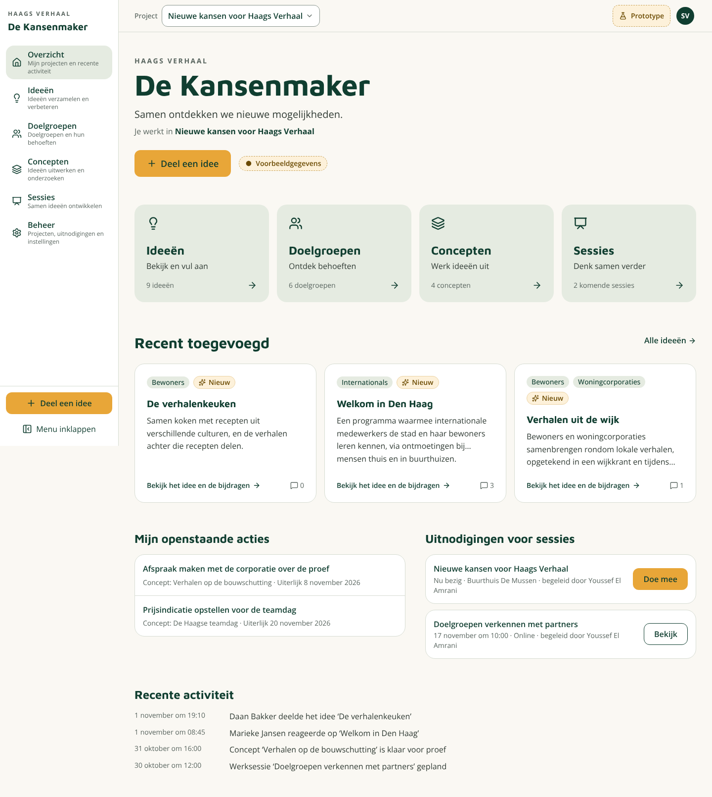 | 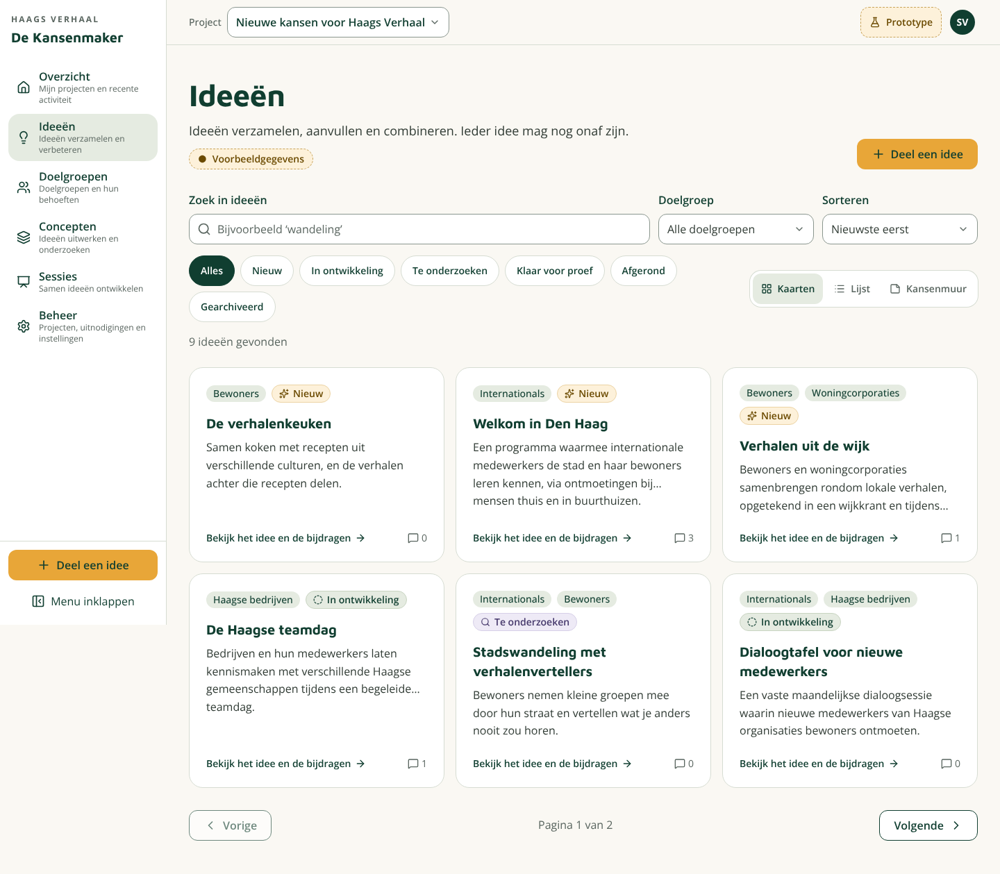 |
| 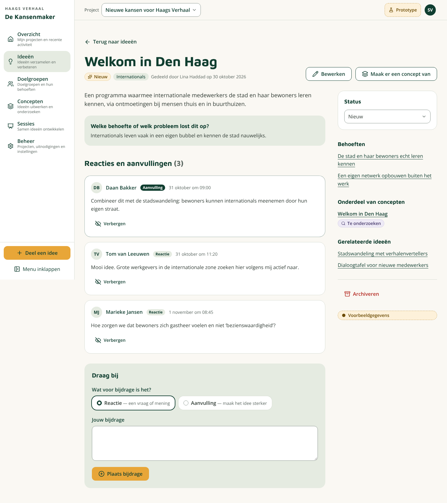 | 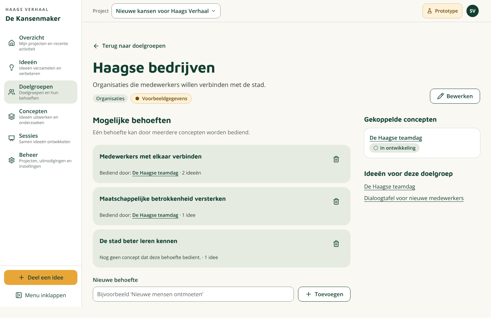 |
| 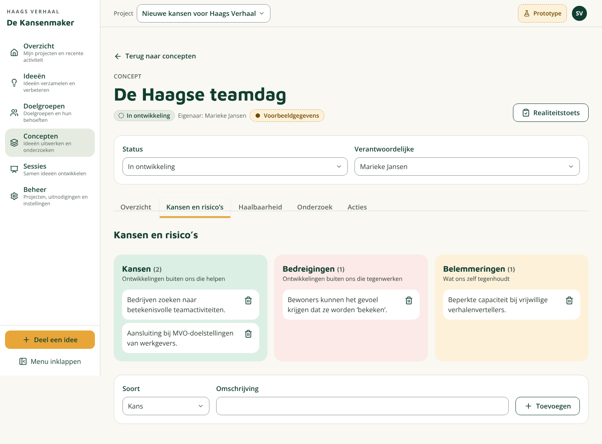 | 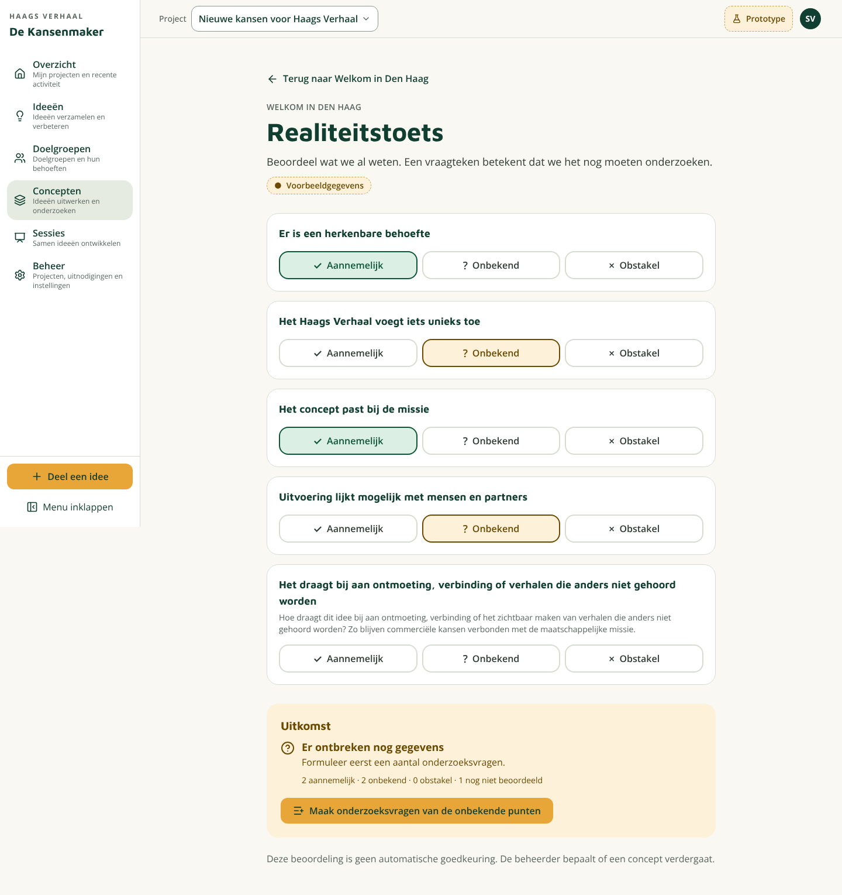 |
| 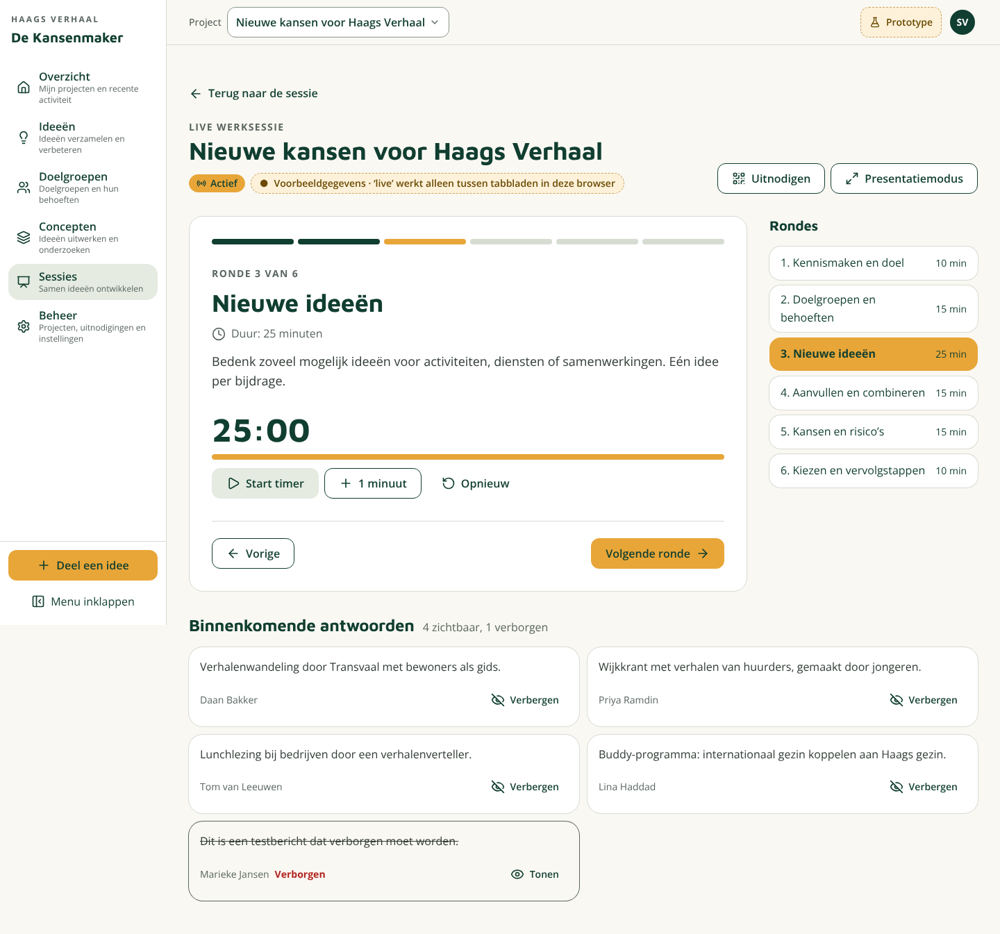 | 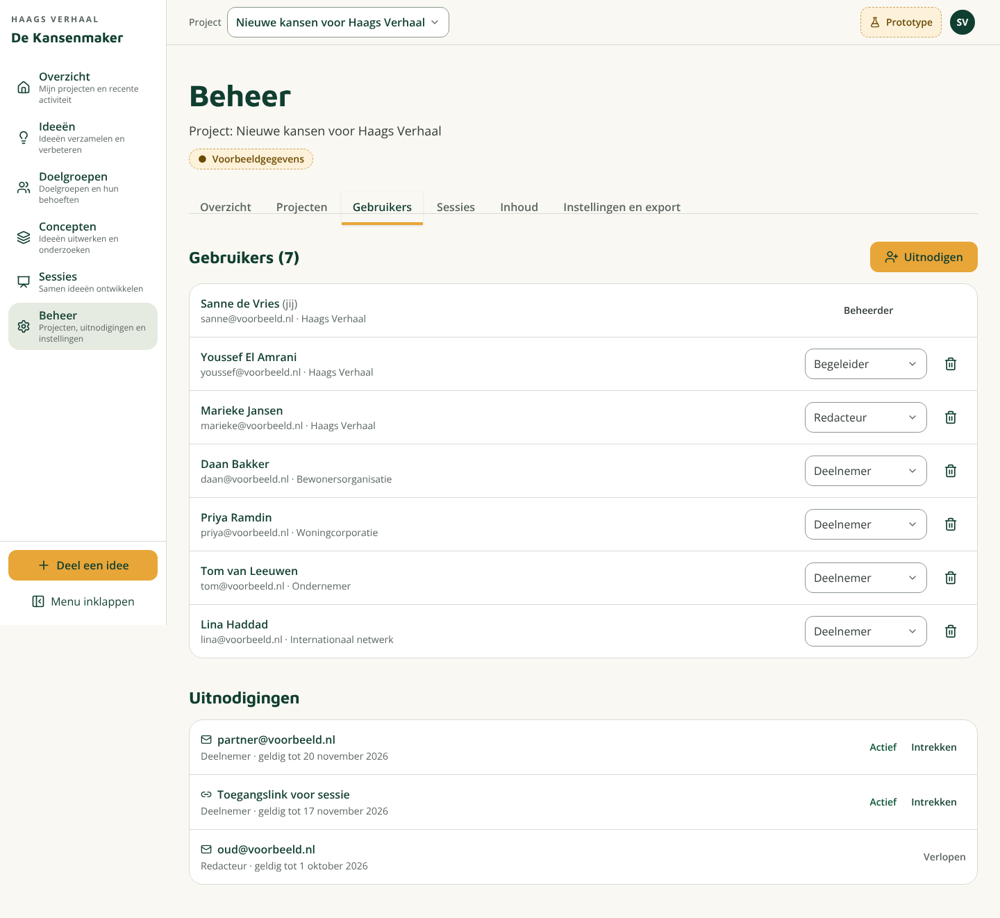 |

| Tablet | Mobiel | | | |
|---|---|---|---|---|
| 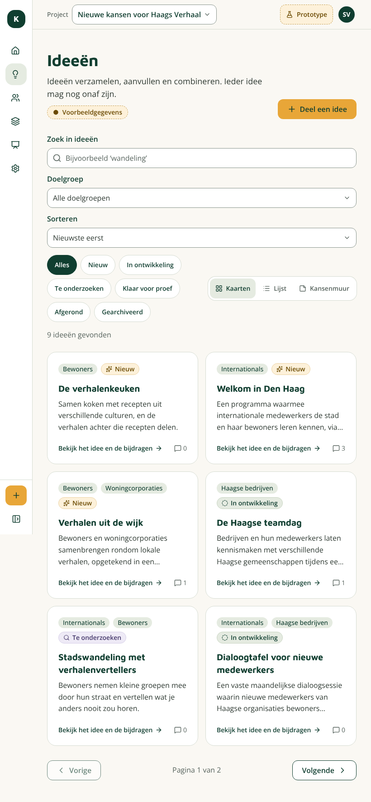 | 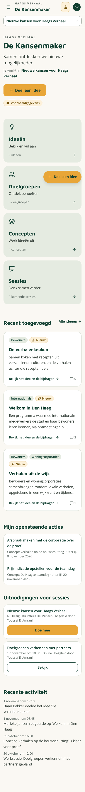 | 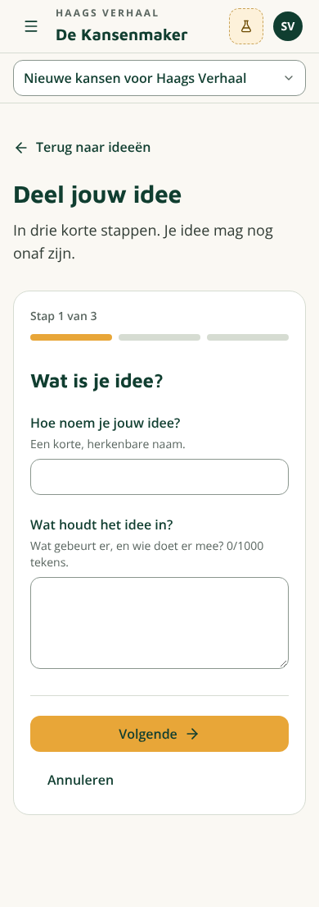 | 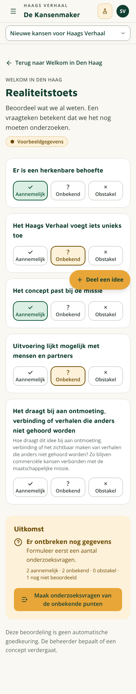 | 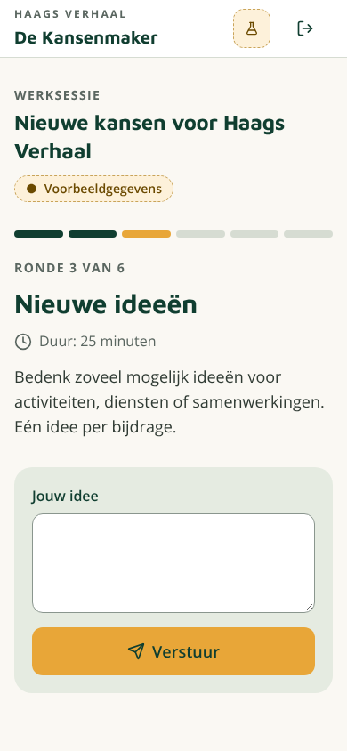 |
